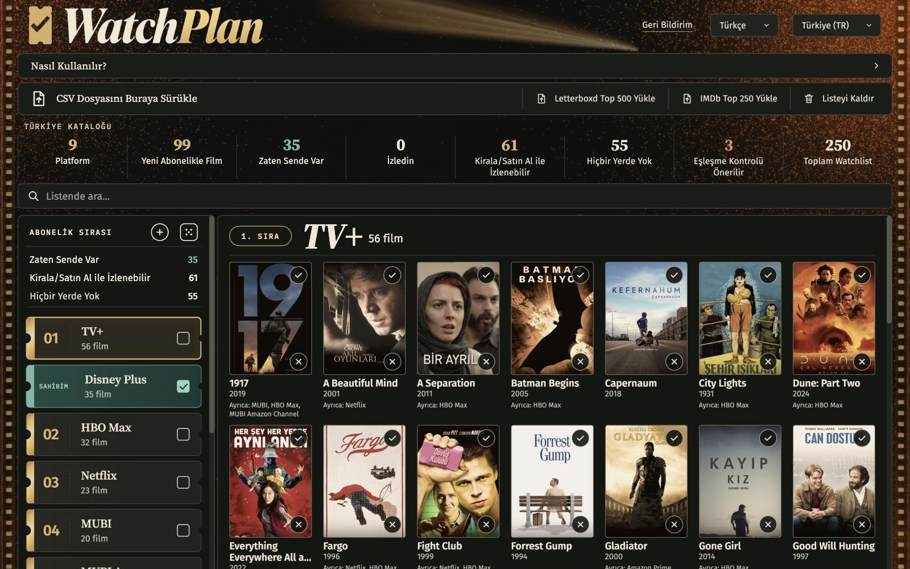
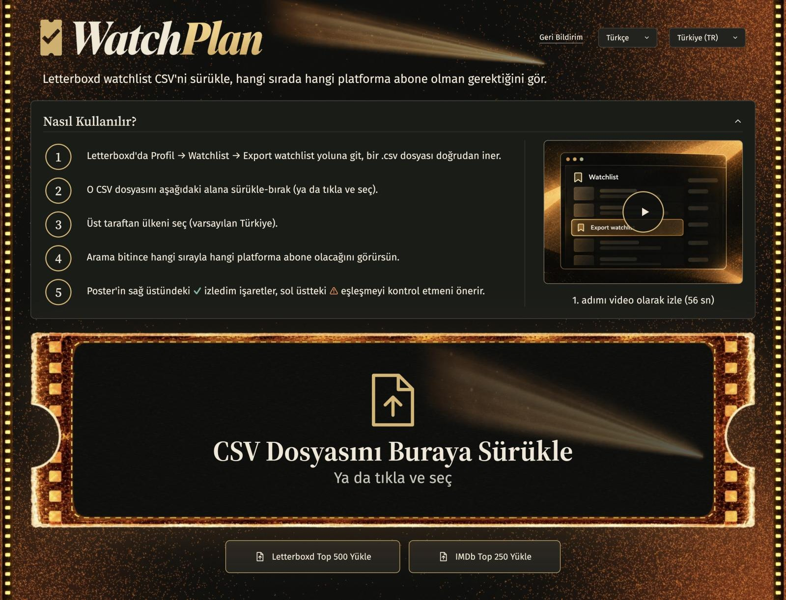
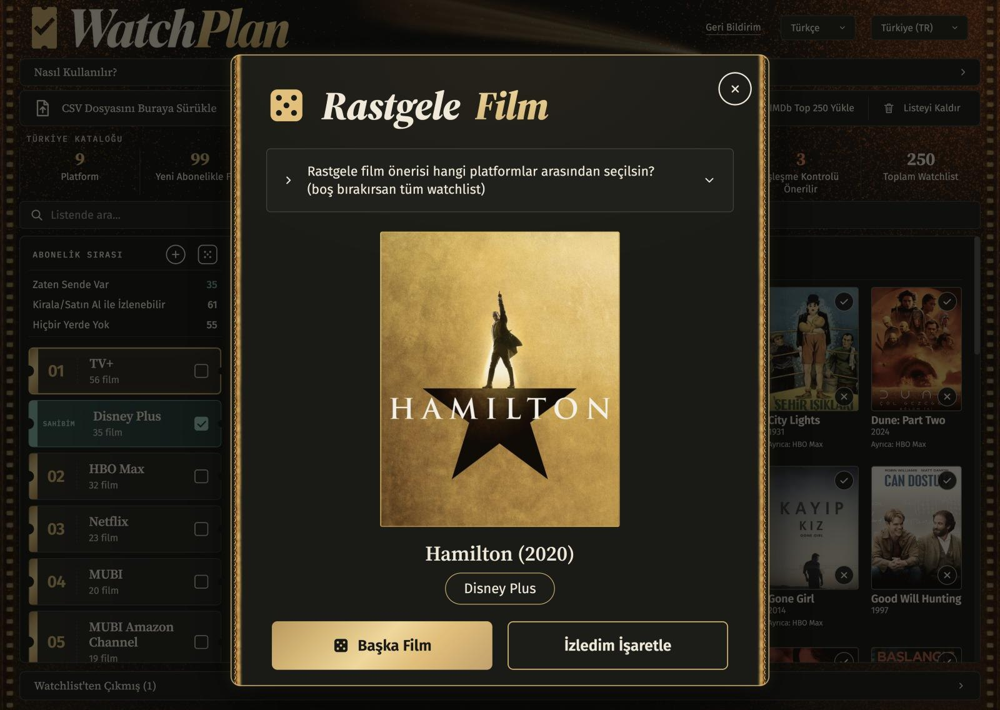
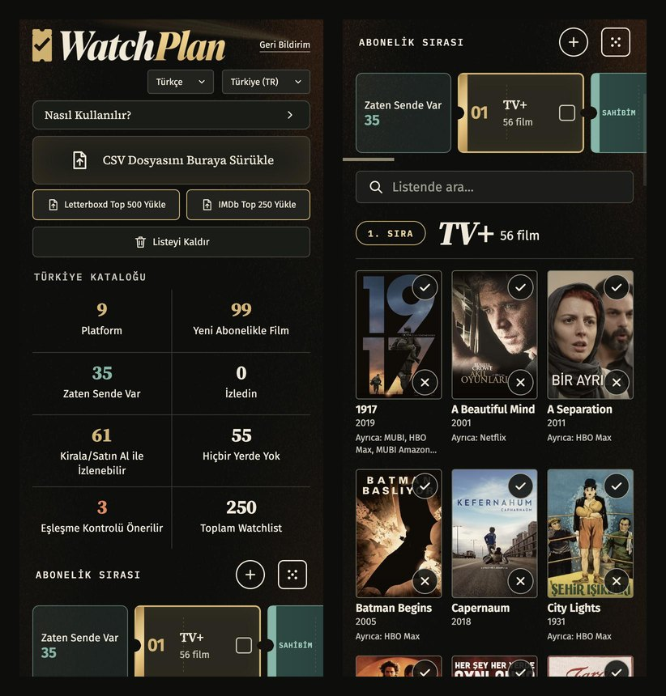

<p align="center">
  
</p>

<p align="center">
  <b>Which streaming services should you subscribe to, and in what order, to get through your Letterboxd watchlist as fast as possible?</b>
</p>

<p align="center">
  <a href="https://watchplan.onrender.com"><b>Try it live → watchplan.onrender.com</b></a>
</p>

---

## What it does

Upload the CSV that Letterboxd exports for your watchlist. WatchPlan looks every film up on JustWatch for your country and turns the result into a plan:

- **A subscription order.** Each platform is a ticket, ordered by how many of your films it carries. Pick a ticket to see its films. The order never jumps around when you tick a service you already own.
- **What you can already watch.** Tick the services you already pay for and their films move to *Zaten Sende Var* ("you already have these") and the plan is recalculated for the rest.
- **Rent or buy.** Films with no subscription option, with their rent/buy prices, cheapest first.
- **Nowhere.** Films that aren't streaming anywhere in your country right now.

Mark films as watched, add or remove films without re-exporting from Letterboxd, fix a wrong match from JustWatch's candidates, search inside your list, or let a die pick tonight's film.



## Screenshots

| First visit | Random pick |
|---|---|
|  |  |

<p align="center">
  
</p>

## Features

- 20 countries, Turkish and English interface
- Two sample lists to try it without an account: IMDb Top 250 and Letterboxd Top 500
- Remembers your watchlist, owned services and watched films between visits
- Flags uncertain matches (remakes, same-title films) and lets you pick the right one
- Works on phones: the ticket list becomes a swipeable strip

## How it works

- **Matching.** Films are searched on JustWatch's GraphQL API, through [simple-justwatch-python-api](https://github.com/Electronic-Mango/simple-justwatch-python-api). A match needs the year and the title to agree; when they don't, the film is flagged for review instead of silently guessing.
- **Being gentle with an unofficial API.** Searches are batched with GraphQL aliases (many titles per request), common titles are answered from a pre-fetched index of the country's popular catalog, and concurrency adapts with an AIMD limiter that backs off when JustWatch starts refusing requests. Results are cached and shared, so a film is only ever looked up once per country.
- **The plan.** A greedy set cover works out how few subscriptions cover the whole list: repeatedly pick the platform that covers the most films not yet covered, until nothing is left. Owned services and watched films are applied in the browser, so toggling them is instant.
- **Stack.** A small Python standard-library HTTP server, vanilla HTML/CSS/JS on the front end, Upstash Redis for storage when hosted, Render for hosting.

## Run it locally

```bash
pip install -r requirements.txt
python server.py
```

It opens http://localhost:8765. Without Upstash credentials everything is stored in local files.

There is also a command-line version that prints the plan and writes `plan.json`:

```bash
python sync.py watchlist.csv --country TR --owned "Netflix,Disney Plus"
```

## Notes

- JustWatch has no official public API. If they change it, searches can break until the library catches up.
- Only subscription (flatrate) offers count toward the plan; rent/buy is shown separately.
- The interface is Turkish by default and switches to English for other countries or from the language menu.

---

Made by [Abdullah Dedeoğlu](https://github.com/abdullahdedeoglu).
